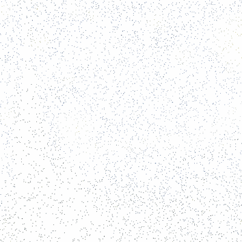
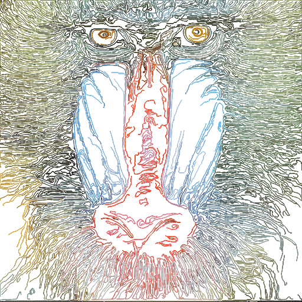
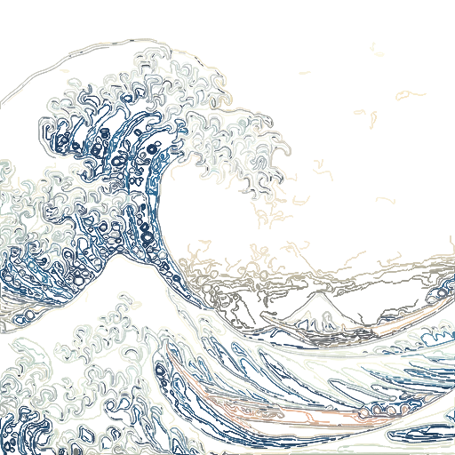
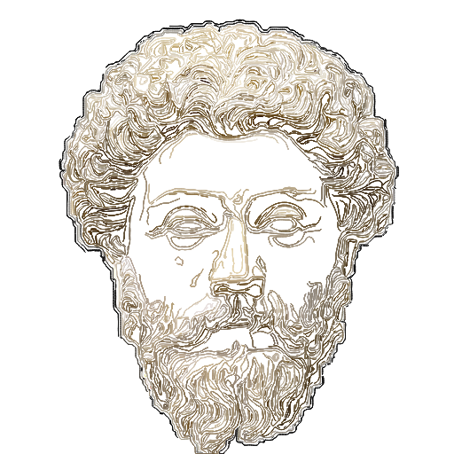

# EdgeFlowArt.jl

<p align="center">
  
</p>

EdgeFlowArt.jl turns an image into thousands of flowing strokes that trace its
edges and textures. Particles are dropped on the image's edges and then follow
the local direction of the image — along hair, brushwork, waves, folds — until
they run into another stroke. Every trajectory becomes one line, colored by the
pixels it passes over.

The result is line art that keeps the *flow* of the original: Van Gogh's swirls
stay swirls, fur stays fur. Output is SVG (vector, scalable), an anti-aliased PNG
preview, and a GIF where every stroke grows from a dot to its full length.

<p align="center">
  
  
  
</p>

## Algorithm

1. **Flow field.** Compute the smoothed structure tensor of the image,
   $J = G_\sigma * (\nabla I\, \nabla I^T)$. Its minor eigenvector points *along*
   edges; its strength $\sqrt{\lambda_1 - \lambda_2}$ is high where the orientation
   is coherent (a clear edge or texture) and near zero on flat areas or noise.
   The field is soft-normalized, $F / (|F| + \varepsilon)$, so strokes move fast
   on strong edges and barely move on noise.

2. **Seeds.** Pick random pixels whose edge strength (Sobel magnitude) is above
   $\min(\tau,\ \text{top 10\%})$, so even low-contrast images get seeds.

3. **Tracing.** Take seeds one at a time. From each seed, follow the field in both
   directions. The field is an *orientation* ($F$ and $-F$ mean the same thing), so
   every step is aligned with the stroke's current heading, and bilinear sampling
   flips neighbouring vectors to agree before blending.

4. **Spacing.** A 3 px occupancy grid records which stroke passed where. A stroke
   stops when it enters a cell owned by another stroke, and a seed landing in a
   taken cell is skipped. Strokes never pile up, early strokes run long, and later
   ones fill the gaps — `--points` is an upper bound, not the stroke count.

5. **Color & tone.** Each stroke takes the mean source color along its path, and its
   width follows that color's darkness (dark ≈ 3× base, light ≈ hairline), so the
   drawing keeps the source's light/dark contrast.

6. **Output.** SVG polylines; the PNG and GIF are rasterized with anti-aliased round
   stamps at the same widths. The GIF grows every stroke from its seed dot.

## Usage

```bash
just install
julia --project=. -O3 -t 8 main.jl -i input.jpg -o out.svg,out.png,out.gif
```

```
--input, -i INPUT           source image (center-cropped to a square)
--output, -o OUTPUT         .png / .svg / .gif (comma-separate for several)
--size, -s S                canvas size in px                    default 512
--points N                  max seeds; taken cells are skipped   default 20000
--tau T                     edge threshold for seeds             default 0.05
--sigma S                   structure-tensor smoothing (px)      default 5.0
--steps K                   max steps per direction from seed    default 400
--eta E                     step size (px per step)              default 1.0
--stroke-width W            base width, scaled by darkness       default 1.2
--opacity A                 stroke opacity                       default 0.9
--seed N                    RNG seed                             default 42
--verbose
```

**Tuning:**

- **Denser / sparser:** `--tau` matters most. Lower values let weaker edges and texture
  seed strokes (0.02 fills almost everything, including noise); higher values give a
  clean outline drawing (0.15). Raise `--points` if edges are left uncovered.
- **Smoother / more detailed:** `--sigma` 5 gives long coherent strokes; 1.5–3 follows
  finer detail but strokes wiggle on noise.
- **Bolder / lighter:** `--stroke-width` scales every stroke; lower `--opacity` for a
  softer look.

**What works well:** images with strong, coherent direction — impasto paintings
(Van Gogh), fur, hair, feathers, waves, wood grain, sculpture, engravings.
**What doesn't:** large flat or smooth areas (left white), dark noisy backgrounds
(turn into dark squiggles), tiny details at 512 px.

## Tests

```bash
just test    # synthetic fixtures: field, seeding, spacing, sampling, raster, GIF
just check   # JET lint + tests + shellcheck
```

Quality sweep over your own images (put them in `test/fixtures/`, not versioned):

```bash
PHASE=baseline ./test/scripts/baseline.sh
julia --project=. test/scripts/metrics.jl baseline   # → test/results/metrics.csv + sheet_tangent.png
```

Metrics (SVG polylines vs. source): `edge_prec` / `edge_rec` (ink on edges / edges inked),
`flat_ink`, `pile_p99` / `pile_max` (strokes per pixel), `dE` (stroke vs. source color),
`turn` (zigzag), `len`, `svg_kb`. They're a guide, not a judge — `flat_ink` also counts
texture strokes that are wanted; compare the contact sheets.

## Requirements

Julia ≥ 1.10. Packages (installed by `just install`): ArgParse, Colors, FileIO, Images,
ImageFiltering, ImageMorphology, Clustering.

## Layout

```
EdgeFlowArt.jl/
├── main.jl                  # CLI
├── src/
│   ├── EdgeFlowArt.jl       # Config + render()
│   ├── fields.jl            # structure-tensor tangent field, edge mask
│   ├── particles.jl         # seeding, orientation sampling, spaced tracing
│   ├── render.jl            # SVG, anti-aliased PNG, growth GIF
│   └── common.jl            # shared with StringArt.jl / MonteCarloArt.jl
├── test/                    # runtests.jl + sweep scripts
└── examples/
```

## Related

- [StringArt.jl](https://github.com/neumann-mlucas/StringArt.jl): an image from a single thread wound around nails.
- [MonteCarloArt.jl](https://github.com/neumann-mlucas/MonteCarloArt.jl): pointillism with Monte Carlo stroke placement.

## Ideas

- **Hatching:** seed new strokes at a fixed offset beside existing ones (Jobard–Lefer) to shade flat regions.
- **Dark canvas** for images with dark backgrounds.
- **Palette lock** (reuse `kmeans_palette_lab`).
- **Perlin blend:** mix in noise for Fidenza-style curves.
